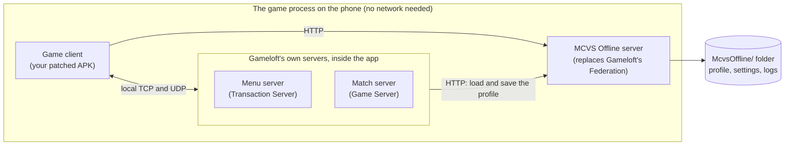

<div align="center">

# MCVS Offline

**Modern Combat Versus, playable offline, with your progress kept on your phone.**

A preservation project for Gameloft's Modern Combat Versus (Android, APK 1.17.32).

No download: you turn your own copy of the game into the offline version on your PC.
[How to play offline →](docs/PLAYER-SETUP.md)


[](https://github.com/Swarce/mcvs-offline/actions/workflows/ci.yml)
[](LICENSE)

[Quick start](#getting-started) · [How to play offline](docs/PLAYER-SETUP.md) · [Status](#status) · [Architecture](docs/ARCHITECTURE.md) · [Roadmap](docs/ROADMAP.md)

</div>

---

## What is this

Modern Combat Versus needs Gameloft's online services to start, and those services are gone. The game itself still
ships everything else: its own match and menu servers, the bots, the rules and the rewards. Only the backend it talks
to, Gameloft's **Federation** service, is missing.

MCVS Offline reimplements that backend as a small C# server that runs **inside the game process**. A patcher adds it to
**your own** copy of the game, on your own computer. The result is an APK that plays fully offline: bot matches with
full rewards, progression saved on the device, and every item obtainable.

The repository contains no game files. You bring your own APK; the project brings the server and the patcher.

## Features

**Play offline**

- Boots to the menu and plays with no internet connection and no Gameloft servers.
- Bot-filled PvP matches that start at once, with full rewards and progression: **Battle › Classic multiplayer**.
  The game has no visible bot-match tile: its own "Practice" tile is hidden in the shipped data (the optional
  `crm.practiceTile` setting shows it; untested).
- **Special Event** in the Battle menu is the game's Arena mode (Havoc, Blitz, Competitive and other twists), with
  its events generated by live ops.
- Tournaments are the game's private matches: no bots fill them and they give no trophies, currency or agent XP, by
  the game's design. Play them with other players on LAN; use Classic for bot matches.
- Live ops generated from the clock: weekly division seasons, daily missions and weekly events.
- Installs the game data from a backup, a copied `Data/` folder or a mirror, without Gameloft's download servers.

**Your progress**

- Progression, inventory and currencies saved on the device, with atomic writes, automatic backups and recovery from a
  corrupt file.
- An in-game **MCVS Offline page** for settings, save backups, logs you can share, and save export and import between
  phones without a PC.

**Everything obtainable**

- A VersusCoins shop for every item category.
- Unlock codes: `UNLOCKALL`, smaller split codes, `UNLOCKPAID`, and the opt-in `UNLOCKUNRELEASED`.
- The **Cosmetic crate**: a play path for the ~600 released items that never had a source in the game.

**Looks and compatibility**

- Graphics profiles (`auto`, `mid`, `high`, `ultra`), using Gameloft's own GPU profiles.
- **HD textures** from the PC (Steam) version, which has many textures at twice the phone's resolution: an ASTC pack
  for most recent phones (Galaxy S22 and newer), ETC packs for older GPUs. You build them yourself from your own Steam
  files; see [tools/hd-textures](tools/hd-textures/README.md).
- Targets Android 15, so Play Protect does not warn that the app was built for an older version of Android.

**For tinkerers**

- A standalone server for a PC: run the unmodified game against it and watch every request.
- `settings.json` for the economy multipliers, unlock-all, the game's developer menu and more.
- Per-service protocol notes, a module guide and the full device-test history.

## Status

Current player build: **12**. The game works offline on a Samsung Galaxy S22 (Android 16): boot, bot matches, saves,
the shop, the MCVS Offline page and the HD textures. A few newer features are built and waiting for a phone test. Expect rough edges and keep your backups.
[docs/STATUS.md](docs/STATUS.md) has the detailed history of every build and device test.

| Goal | Status |
|---|---|
| Fully offline boot to the menu | Works (tested on a phone) |
| Bot matches with full rewards | Works (tested on a phone) |
| Progression saved on the device | Works (tested on a phone) |
| Shop and unlock codes | Works (tested on a phone) |
| Offline data install from a backup or copied data | Works (tested on a phone) |
| Live ops from the clock | Works (tested on a phone) |
| MCVS Offline page: settings, saves, logs | Works (tested on a phone) |
| Cosmetic crate | Built, waiting for a phone test (the crate starts with a later season) |
| Target Android 15 | Works (builds 10 to 12 installed and played on a phone) |
| Graphics profiles | Works (tested on a phone) |
| HD textures (ASTC and ETC packs) | Works: the ASTC pack on a Galaxy S22, at the same frame rate as the stock textures |
| Game Mode flags (Android 'game' patch) | Built (build 13), waiting for a phone test |
| PC (Steam) port | Second Windows test done (install, start and menu work; the game ran its own `Game.dll`, fixed in build 14). Ready for the third: the kit and [docs/PLAYER-SETUP-PC.md](docs/PLAYER-SETUP-PC.md) on the `wip/pc-port` branch |
| LAN multiplayer | Experimental: guests use the host's server for everything |
| Internet multiplayer | Planned (overlay VPN guide first) |
| Preservation extras | In progress: CDN mirror and backup verifier done; missing maps not started |

## How it works

The game ships its own match and menu servers (Gameloft calls them the **Game Server** and the **Transaction Server**)
and can run them inside the app. What died is the online account backend, **Federation**: login, cloud saves, offers,
matchmaking and more. Because those servers load and save your profile through Federation, a local Federation server
gives full saves without changing the game's logic.



The patcher adds the server DLL to your APK, hooks the game so the server starts first, applies a set of fixes, and
re-signs the APK with your key. Every patch site is checked against the exact code of 1.17.32 first; if anything
differs, the patcher stops without writing.

More: [docs/ARCHITECTURE.md](docs/ARCHITECTURE.md) (normative design) and the research notes in
[docs/research/](docs/research/).

## Getting started

### For players

The full guide, with every command: **[docs/PLAYER-SETUP.md](docs/PLAYER-SETUP.md)**.

You need:

- an Android phone with the original game (APK 1.17.32, a single APK, not split);
- a PC with the [.NET 8 SDK](https://dotnet.microsoft.com/download/dotnet/8.0): Linux or macOS, or Windows with WSL
  (the build scripts are bash scripts);
- `adb`, with USB debugging on.

1. **Back up.** Pull your APK and the game's data folder (about 1.5 GB) to the PC. Android deletes the data when the
   original game is uninstalled.
2. **Build and patch.** Build the server against the libraries in your own APK, then let the patcher turn your APK into
   the offline APK. Back up the signing key it creates: updates must use the same key.
3. **Install.** Uninstall the original, install the offline APK, and restore your data backup before the first launch.
4. **Optional: HD textures.** Build an HD pack from your own Steam copy with
   [tools/hd-textures](tools/hd-textures/README.md) and push it to the phone
   ([PLAYER-SETUP.md](docs/PLAYER-SETUP.md) section 7, [INSTALL-OFFLINE.md](docs/INSTALL-OFFLINE.md)).

Keep your original APK unmodified. It is the only source for future patches.

### For developers

Requirements: the [.NET 8 SDK](https://dotnet.microsoft.com/download/dotnet/8.0) and a bash shell. The embedded build
and the real-client conformance tests also need the `assemblies/` folder of your own 1.17.32 APK.

```sh
unzip -o mcvs.apk 'assemblies/*' -d mcvs-apk
MCVS_REFS="$PWD/mcvs-apk/assemblies" scripts/build.sh   # solution, embedded server DLL, all tests
scripts/run-standalone.sh --log-level debug             # Federation server on http://127.0.0.1:51780/
```

Without `MCVS_REFS`, `build.sh` builds and tests the net8 projects and skips the embedded build. The other test
switches are listed in `scripts/build.sh` and [docs/DEV-LOOP.md](docs/DEV-LOOP.md).

**Development loop.** The unmodified game on a phone, the server on a PC, one USB cable. Nothing is patched; every
request shows up in the PC's log. Step by step, including the `args.txt` the game needs:
[docs/DEV-LOOP.md](docs/DEV-LOOP.md).

Shared server code is C# 7.3 and must also compile against the game's trimmed Mono class library: no `async`/`await`,
no `HttpListener`, no Newtonsoft. The rules are in [docs/MODULES.md](docs/MODULES.md) and
[docs/ARCHITECTURE.md](docs/ARCHITECTURE.md) §2.1.

## Configuration

Most settings can be changed on the phone, on the **MCVS Offline page** (Settings › Account › MCVS Offline, or the
MCVS Offline message in the inbox). Each setting there says when it applies.

Underneath, everything lives in `settings.json` (in the game:
`/sdcard/Android/data/com.gameloft.android.ANMP.GloftMVHM/files/McvsOffline/`; standalone: `./data/`). A few keys:

| Key | Default | Meaning |
|---|---|---|
| `unlockAll` | `false` | Grant every merc, weapon, gear slot, signature, camo, accessory and skin through your inventory |
| `economy.*Multiplier` | `1.0` | Credits, VersusCoins, XP and store-price multipliers |
| `graphics.profile` | `auto` | Graphics profile: `auto`, `mid`, `high` or `ultra` (after a restart) |
| `hd.enabled` | `true` | Install the HD pack in `McvsOffline/hd/`; `false` removes it at the next start |
| `crm.practiceTile` | `false` | Show the game's hidden PRACTICE bot-match tile in the main menu (untested placement and art) |

All keys: [docs/PLAYER-SETUP.md](docs/PLAYER-SETUP.md) section 8 (the in-game host) and the per-module protocol notes
in [docs/PROTOCOL.md](docs/PROTOCOL.md).

## Project layout

<details>
<summary>Folders and what they hold</summary>

```
server/              McvsOffline.Server: one source tree compiled twice (net8, and the game's trimmed Mono BCL)
  Core/              HTTP/1.1 server on raw sockets, router, MiniJson, accounts and tokens, durable storage,
                     settings, logging, data-pack reader (GCBF/LZ4)
  Services/          one folder per Federation service (Eve, Pandora, Auth, Storage, Crm, Matchmaker, Assets,
                     Social, Messaging, Alerts, Leaderboards, GameStats, ...), plus Unlocks and Admin (the in-game page)
  Content/           generated store catalogue, economy, live ops, unlock groups (ids and prices only); the page
hosts/standalone/    net8 console host: dev loop, LAN host, conformance target
hosts/embedded/      the in-game host: start-up, args.txt, diagnostics, page hooks, offline data install, HD installer
patcher/             McvsOffline.Patcher (net8 + Mono.Cecil): your APK -> the offline APK
tests/               McvsOffline.Tests (server, real-client conformance), McvsOffline.Embed.Tests (embedded host,
                     patcher, HD installer), McvsOffline.PcSpike.Tests (PC test kit)
tools/content-gen/   generator for server/Content from the decoded data pack (Python, standard library only)
tools/cdn-mirror/    mirror Gameloft's data CDN and verify backups against its CRC index (Python, standard library only)
tools/hd-textures/   PC textures to HD packs for the phone: the ASTC data pack or ETC packs (net8)
tools/pc-spike/      Windows test kit for the Steam version (one exe)
tools/art/           icon exporter and previews for the project's own art (Python, Pillow)
art/android/         the project's own launcher icon and launch-screen art (empty until drawn)
scripts/             build.sh, run-standalone.sh
docs/                architecture, status, guides, protocol notes, designs, research
```

</details>

## Documentation

| Document | What it covers |
|---|---|
| [ARCHITECTURE.md](docs/ARCHITECTURE.md) | The design (normative) and the build constraints |
| [STATUS.md](docs/STATUS.md) | What is implemented, how it was checked, every device test, the next checklist |
| [PLAYER-SETUP.md](docs/PLAYER-SETUP.md) | Building and installing the offline APK; the MCVS Offline page; logs |
| [INSTALL-OFFLINE.md](docs/INSTALL-OFFLINE.md) | Installing the game data without Gameloft's servers; the HD packs |
| [DEV-LOOP.md](docs/DEV-LOOP.md) | The unmodified game against the standalone server |
| [ECONOMY.md](docs/ECONOMY.md) | The offline economy, unlock codes, the Cosmetic crate, tuning |
| [LIVEOPS.md](docs/LIVEOPS.md) | Division seasons, daily missions and weekly events |
| [MODULES.md](docs/MODULES.md) | Module ownership, the module seam, core APIs, rules for code that runs in the game |
| [PROTOCOL.md](docs/PROTOCOL.md) | Index of the per-service protocol notes in [protocol/](docs/protocol/) |
| [ROADMAP.md](docs/ROADMAP.md) | Done, next and later |
| [PC-SPIKE.md](docs/PC-SPIKE.md) | The Windows test kit for the Steam version |
| [design/](docs/design/) | [Settings page](docs/design/settings-page.md), [Cosmetic crate](docs/design/economy-collector.md), [HD texture packs](docs/design/hd-textures.md), [HD installer](docs/design/hd-install.md) |
| [research/](docs/research/) | Reverse-engineering reports; where they disagree, the `verify-C*` notes are the checked result |

## Roadmap

- **Next:** the PC (Steam) port, a phone test of the Cosmetic crate, and Android's game
  category for the patched APK (so Game Mode and Samsung's Game Booster treat it as a game).
- **Later:** the project's own icon art, LAN multiplayer, internet multiplayer, and preservation extras (a full CDN
  mirror, maps from older builds).

Details: [docs/ROADMAP.md](docs/ROADMAP.md).

## Reporting issues

Bug reports from real devices are the most useful contribution. Please include:

- the player build (on the MCVS Offline page, under Status), your phone model and Android version;
- what you did and what happened; for a hang, wait at least 60 seconds before closing the game, so the watchdog can log
  what it waits for;
- the logs. On the phone: MCVS Offline page › Logs › **Build**, then **Share** (the "Recent" scope stays under 8 MB).
  Without the page: Files › Downloads › MCVS-Offline, the files of the newest start. With a PC:
  `adb logcat -s McvsOffline mono-stdout`.

Never attach your APK, game data, an HD pack or a signing key. More on logs: [PLAYER-SETUP.md](docs/PLAYER-SETUP.md)
section 6.

## Legal

This repository contains **no Gameloft files**: no APK, no assemblies, no decompiled code, no game data and nothing
derived from them, except generated item ids and prices. The build compiles against the libraries in the player's own
APK, the patcher modifies the player's own APK on the player's machine, and the server reads the player's own data pack
at runtime. HD packs are converted on the player's computer from the player's own files and must not be shared. The
`.gitignore` refuses binaries, data-pack and texture files (`*.f`, `*.ktx`), ETC HD packs (`mcvs-hd-*.zip`),
decompiled sources and signing keys.

Modern Combat Versus and all related names are trademarks of Gameloft. This is an unofficial, non-commercial
preservation project with no affiliation to Gameloft.

The project's own code and documentation are licensed under the [Mozilla Public License 2.0](LICENSE). The license
covers only this repository: it grants no rights to Modern Combat Versus or any Gameloft file, name or asset.

## Acknowledgements

- **Gameloft**, the original developer of Modern Combat Versus.
- [Mono.Cecil](https://github.com/jbevain/cecil), which the patcher uses to read and rewrite the game's assemblies.
- [ARM astc-encoder](https://github.com/ARM-software/astc-encoder) (Apache License 2.0), which `tools/hd-textures`
  runs to encode the ASTC data pack. It is not part of this repository.
- [ILSpy](https://github.com/icsharpcode/ILSpy), used in the reverse-engineering research.
